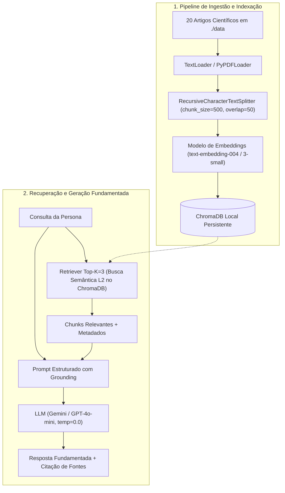

# Residência em IA — Semana 2: Base de Conhecimento e Recuperação (Primeiro Mecanismo RAG)

Este repositório contém a entrega da **Semana 2 da Residência em IA**, implementando um pipeline modular, auditável e resiliente de **Retrieval-Augmented Generation (RAG)** voltado para orientação de estudos, produtividade sustentável e preparação estratégica por editais e trilhas autodidatas.

---

## Sumário

1. [Visão Geral e Arquitetura](#1-visão-geral-e-arquitetura)
2. [Estrutura do Repositório](#2-estrutura-do-repositório)
3. [Base de Conhecimento Curada (20 Artigos Científicos)](#3-base-de-conhecimento-curada-20-artigos-científicos)
4. [Decisões Técnicas do Pipeline RAG](#4-decisões-técnicas-do-pipeline-rag)
5. [Personas e Cenários de Validação](#5-personas-e-cenários-de-validação)
6. [Como Configurar e Executar](#6-como-configurar-e-executar)

---

## 1. Visão Geral e Arquitetura

O sistema conecta uma base de conhecimento científica a um Grande Modelo de Linguagem (LLM), garantindo respostas fundamentadas (*grounded generation*) com citação explícita das fontes e mitigação de alucinações.



---

## 2. Estrutura do Repositório

```text
Challenge2-project/
├── data/                           # 20 documentos científicos (.txt) gerados/ingeridos pelo pipeline
├── chroma_db/                      # Persistência local do banco vetorial ChromaDB
├── rag_pipeline_semana2.ipynb      # Notebook principal com as 5 etapas do pipeline RAG
├── Entrega2.md                     # Documento de apoio da entrega da Semana 2
├── .env                            # Variáveis de ambiente (OPENAI_API_KEY ou GOOGLE_API_KEY) [opcional]
└── README.md                       # Documentação do repositório
```

---

## 3. Base de Conhecimento Curada (20 Artigos Científicos)

A base de conhecimento em `./data/` é composta por **20 documentos baseados em literatura científica** de psicologia cognitiva, neurociência do aprendizado e engenharia de produtividade, organizados em **4 blocos temáticos**:

| Bloco Temático | Documentos | Referências Principais |
| :--- | :--- | :--- |
| **1. Retenção e Neurociência** | Docs `01` a `05` | *Active Recall* (Karpicke & Roediger, 2008), Repetição Espaçada (Cepeda et al., 2006), Prática Intercalada (Rohrer & Taylor, 2007), Teoria da Carga Cognitiva (Sweller, 2005) e Consolidação da Memória no Sono (Walker, 2009). |
| **2. Foco e Produtividade** | Docs `06` a `10` | *Deep Work* (Newport, 2016), Resíduo de Atenção (Leroy, 2009), Intenções de Implementação *Se-Então* (Gollwitzer, 1999), *Timeboxing* (Allen & Pozen, 2012) e Técnica Pomodoro (Cirillo, 2006). |
| **3. Comportamento e Procrastinação** | Docs `11` a `15` | Teoria da Motivação Temporal (Steel, 2007), Perfeccionismo e *Overplanning* (Flett & Hewitt, 2002), Loop do Hábito (Wood & Rünger, 2016), Esgotamento do Ego/Fadiga Decisória (Baumeister et al., 1998) e Autoeficácia (Bandura, 1977). |
| **4. Planejamento Autodidata e Editais** | Docs `16` a `20` | Princípio de Pareto 80/20 (Box et al., 1987), Ciclos de Estudo Flexíveis (Meirelles & Perez, 2015), *Project-Based Learning* (Thomas, 2000), Dupla Jornada CLT e Pobreza de Tempo (Martins & Silveira, 2020) e Técnica Feynman (Gleick & Goodstein, 1992). |

> **Resiliência:** Caso a pasta `./data/` esteja vazia ou inacessível, o pipeline aciona automaticamente um *fallback* sintético em memória (`get_synthetic_fallback_documents()`).

---

## 4. Decisões Técnicas do Pipeline RAG

1. **Ingestão Multi-formato Resiliente (`load_knowledge_base`)**:
   - Suporte nativo para arquivos `.txt` (`TextLoader` com UTF-8) e `.pdf` (`PyPDFLoader`), com tratamento isolado de exceções por arquivo.
2. **Segmentação Hierárquica (`split_documents`)**:
   - `RecursiveCharacterTextSplitter` com separadores `["\n\n", "\n", ". ", " ", ""]`.
   - `chunk_size = 500` caracteres e `chunk_overlap = 50` caracteres (10%), gerando **49 chunks** a partir dos 20 documentos originais.
   - Rastreabilidade completa via `add_start_index=True` e atribuição sequencial de `chunk_id` nos metadados.
3. **Vetorização e Persistência Idempotente (`ChromaDB`)**:
   - Suporte automático a `OpenAIEmbeddings` (`text-embedding-3-small`) e `GoogleGenerativeAIEmbeddings` (`models/text-embedding-004`).
   - **Modo Offline Integrado:** Inclui `LocalKeywordHashEmbeddings` (vetores de 256 dimensões normalizados em $L_2$) e `GroundedExtractiveFallbackLLM` para permitir a execução completa do notebook mesmo sem chave de API configurada.
   - Persistência local em `./chroma_db` (coleção `residencia_ia_semana2`) com limpeza prévia de IDs para evitar duplicatas em reexecuções.
4. **Recuperação e Chain RAG (`LCEL`)**:
   - Busca semântica por Distância Euclidiana ($L_2$) com `Top-K = 3`.
   - Orquestração via `RunnableParallel` e `RunnablePassthrough`, preservando tanto os documentos recuperados (`context_docs`) quanto a resposta final (`answer`).
   - Prompt de sistema restritivo (`temperature=0.0`) que exige citação de fonte (`[Fonte: ...]`) e bloqueia extrapolações fora do contexto recuperado.

---

## 5. Personas e Cenários de Validação

O pipeline é validado no final do notebook com **3 consultas reais** simulando as necessidades das personas do projeto:

- **Persona 1 — Lucas (Trabalhador CLT / Concurseiro):**
  - *Dor:* Conciliar expediente de 8h diárias com blocos de estudo eficientes sem sacrificar o sono.
- **Persona 2 — Lisa (Estudante de Engenharia / Estagiária):**
  - *Dor:* Superar o *overplanning* (excesso de planejamento em planilhas e cronogramas rígidos que quebram com imprevistos).
- **Persona 3 — Bob (Universitário / Autodidata em Tecnologia):**
  - *Dor:* Priorizar estrategicamente conteúdos extensos/editais em vez de estudar de forma linear e validar o aprendizado na prática.

---

## 6. Como Configurar e Executar

### Pré-requisitos
- Python `3.10+`
- Jupyter Notebook, JupyterLab ou VS Code com extensão Jupyter

### Passo a Passo

1. **Clone o repositório e acesse a pasta do projeto:**
   ```bash
   git clone <url-do-repositorio>
   cd Challenge2-project
   ```

2. **(Opcional) Crie e ative um ambiente virtual:**
   ```bash
   python -m venv .venv
   # Windows (PowerShell)
   .\.venv\Scripts\Activate.ps1
   # Linux / macOS
   source .venv/bin/activate
   ```

3. **(Opcional) Configure sua chave de API em um arquivo `.env` na raiz do projeto:**
   ```env
   # Escolha um dos provedores abaixo:
   OPENAI_API_KEY="sua-chave-openai"
   # ou
   GOOGLE_API_KEY="sua-chave-google-gemini"
   ```
   *Observação: Caso nenhum arquivo `.env` seja configurado, o notebook executará automaticamente em modo de demonstração offline utilizando os componentes determinísticos locais.*

4. **Execute o Notebook:**
   Abra o arquivo [`rag_pipeline_semana2.ipynb`](rag_pipeline_semana2.ipynb) e execute todas as células sequencialmente (*Run All*). As dependências necessárias serão instaladas automaticamente na Etapa 1.
