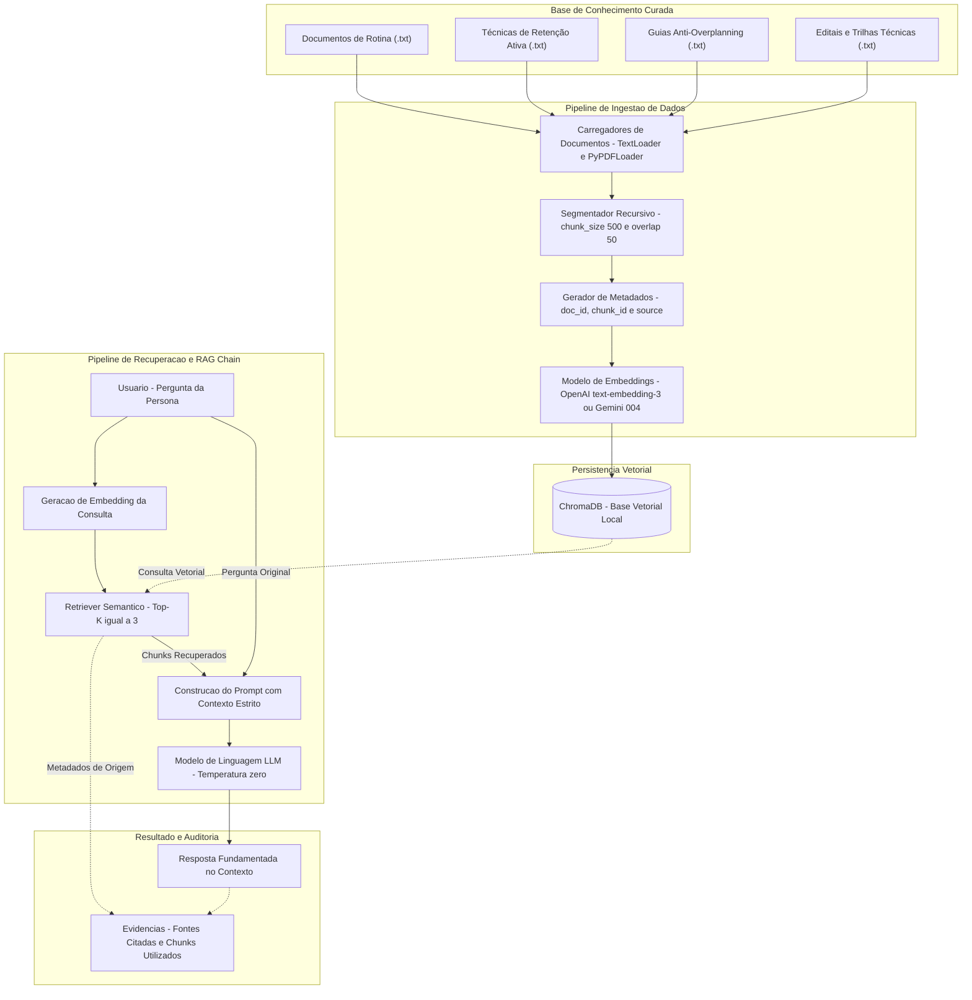

# Diagrama de Arquitetura — Pipeline RAG

**Projeto:** Residência em IA — Semana 2: Base de Conhecimento e Recuperação  
**Objetivo:** Arquitetura para recuperação de informação com alta fidelidade semântica, fundamentação estrita (*grounding*) e rastreabilidade ponta a ponta para suporte a estudantes e profissionais.

---

## 1. Visão Geral da Arquitetura

O sistema é dividido em dois macro-fluxos desacoplados:
1. **Pipeline de Ingestão (Offline/Batch):** Responsável por carregar documentos brutos, validar e sanitizar conteúdo, particionar textos em unidades semânticas (*chunking*), enriquecer metadados, gerar vetores densos (*embeddings*) e indexá-los no banco vetorial.
2. **Pipeline de Inferência e Recuperação (Online/Real-time):** Recebe a pergunta do usuário, gera o embedding da consulta, recupera os fragmentos mais similares no banco vetorial (*Top-K*), constrói o prompt aumentado com contexto e metadados, e submete a um LLM instruído para responder exclusivamente com base nas fontes recuperadas.

---

## 2. Diagrama de Arquitetura do Sistema

---

## 3. Detalhamento dos Componentes

### 3.1. Base de Conhecimento Curada
- **Localização:** Diretório `./data/`.
- **Composição:** Mínimo de 20 documentos-fonte estruturados em tópicos complementares de aprendizagem e produtividade.
- **Formato:** Texto estruturado (`.txt` e `.pdf`), codificação UTF-8, com metadados no cabeçalho ou inferidos no carregamento.

### 3.2. Camada de Ingestão e Processamento
- **Document Loaders:** Suporte a arquivos de texto puro e documentos PDF, com tratamento resiliente de erros por arquivo (evita interrupção da ingestão por falha isolada).
- **Text Splitter:** `RecursiveCharacterTextSplitter` configurado com `chunk_size=500` caracteres e `chunk_overlap=50` caracteres.
- **Gerador de Metadados:** Cada fragmento recebe um identificador determinístico (`doc_id`, `chunk_id`), nome do arquivo fonte (`source`) e rótulo temático (`topic`).

### 3.3. Banco Vetorial (ChromaDB)
- **Engine:** ChromaDB local persistente (`./chroma_db`).
- **Métrica de Espaço Vetorial:** Distância L2 e similaridade angular/cosseno.
- **Responsabilidade:** Armazenamento dos vetores densos e suporte a consultas aproximadas de vizinhos mais próximos (k-NN / HNSW).

### 3.4. Camada de Recuperação e RAG Chain (LCEL)
- **Retriever:** Busca por similaridade semântica configurada para retornar os 3 fragmentos com maior aderência ao vetor da consulta (`k=3`).
- **Prompt Engineering:** Prompt de sistema com política estrita de "Closed-Domain QA", forçando o modelo a responder apenas com fatos contidos no contexto recuperado e declarando explicitamente a ausência de resposta quando o contexto for insuficiente.
- **Execução:** Orquestrado via LangChain Expression Language (LCEL) com paralelismo entre recuperação de contexto e repasse da pergunta.

### 3.5. Auditoria e Rastreabilidade
- Toda resposta gerada referencia os trechos exatos e arquivos de onde o conhecimento foi extraído (`[Fonte: <origem> | Chunk ID: <id>]`), permitindo auditoria humana e mitigando alucinações.
