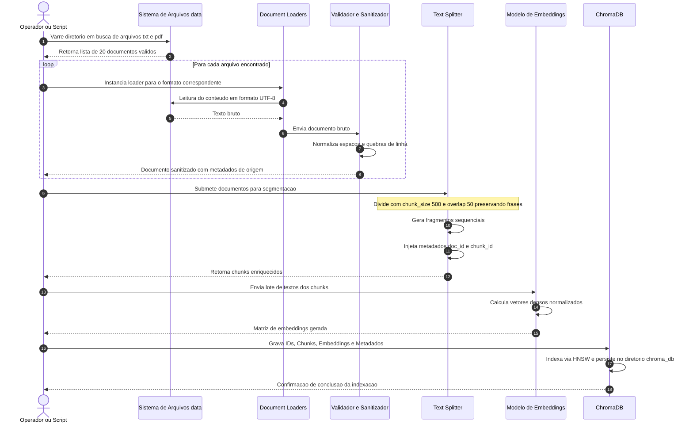

# Pipeline de Ingestão de Dados — Especificação e Fluxo

**Projeto:** Residência em IA — Semana 2: Base de Conhecimento e Recuperação  
**Objetivo:** Descrever em nível técnico o pipeline de ingestão responsável por transformar documentos brutos em coleções vetoriais indexadas e auditáveis.

---

## 1. Visão Geral do Pipeline

O pipeline de ingestão opera em modelo de processamento em lote (*batch processing*), garantindo:
- **Resiliência:** Falhas em arquivos individuais não interrompem o lote completo.
- **Idempotência:** A reexecução da ingestão atualiza ou substitui a coleção existente sem duplicações indesejadas.
- **Rastreabilidade:** Cada fragmento retém sua linhagem de dados (*data lineage*) desde o arquivo-fonte até a partição vetorial.

---

## 2. Diagrama de Sequência do Pipeline de Ingestão

---

## 3. Etapas Detalhadas do Pipeline

### Etapa 1: Descoberta e Seleção de Fontes
- O script inspeciona recursivamente o diretório `./data/`.
- Filtra arquivos pelas extensões suportadas: `.txt`, `.md`, `.pdf`.
- Valida permissões de leitura e descarta arquivos temporários ou ocultos (ex: `.DS_Store`).

### Etapa 2: Carga Resiliente de Documentos
- Para arquivos `.txt`, utiliza `TextLoader` com decodificação `utf-8` e substituição tolerante a erros de caracteres (`errors='replace'`).
- Para arquivos `.pdf`, utiliza `PyPDFLoader` extraindo o conteúdo página a página.
- **Tratamento de Exceções:** Cada arquivo é processado dentro de um bloco `try/except`. Caso um documento esteja corrompido, um log de erro é emitido com o traceback e a ingestão prossegue para os próximos arquivos.

### Etapa 3: Sanitização e Normalização
- Remoção de sequências anômalas de espaços em branco e múltiplos caracteres de quebra de linha.
- Padronização de títulos e cabeçalhos para evitar ruídos de OCR ou formatação desbalanceada.

### Etapa 4: Segmentação Semântica (*Chunking*)
- **Estratégia:** Divisão recursiva orientada à pontuação natural da língua portuguesa.
- **Parâmetros:**
  - `chunk_size = 500`: Janela máxima de caracteres por fragmento.
  - `chunk_overlap = 50`: Margem de sobreposição de 10% entre fragmentos consecutivos.
  - `separators = ["\n\n", "\n", ". ", " ", ""]`: Respeita parágrafos, sentenças e palavras.

### Etapa 5: Enriquecimento de Metadados
Cada chunk gerado recebe metadados estruturados para possibilitar filtros avançados e auditoria:
- `source`: Caminho relativo ou nome do arquivo de origem (ex.: `doc_01_conciliacao_rotina_trabalho.txt`).
- `chunk_id`: Identificador único determinístico no formato `<doc_id>_c<índice>`.
- `topic`: Categoria temática (ex.: `gestao_tempo`, `retencao_ativa`, `anti_overplanning`).
- `char_count`: Quantidade de caracteres contidos no fragmento.

### Etapa 6: Vetorização e Indexação em Lote
- Os textos dos fragmentos são enviados em lotes (*batch size* configurável de até 100 itens) para o modelo de embeddings a fim de respeitar limites de taxa (*rate limits*) de APIs externas.
- Os vetores gerados são persistidos no **ChromaDB**, associando cada vetor ao seu ID e ao dicionário de metadados correspondente.

---

## 4. Estratégia de Fallback e Resiliência

Caso o diretório `./data/` esteja inacessível ou vazio, o pipeline aciona o método de contingência:
1. Emissão de aviso informativo nos logs do sistema.
2. Carga imediata da base sintética em memória (`get_synthetic_fallback_documents()`), garantindo que o protótipo permaneça funcional para testes e demonstrações imediatas.
